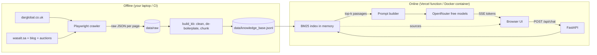

# DarGlobal x Wasalt RAG Chatbot

A retrieval-augmented chatbot that answers questions about **[DarGlobal](https://darglobal.co.uk)**
(London-listed luxury real-estate developer) and **[Wasalt](https://wasalt.sa)** (Saudi real-estate
marketplace) using **publicly available data scraped from both websites**. Answers are generated by a
**free OpenRouter model**, cite their sources, and stream into a clean web UI.

- **Scraping** - Playwright crawler that gets past the sites' bot protection, honours `robots.txt`, and is rate limited.
- **Retrieval** - dependency-free BM25 index over heading-aware chunks (fast cold starts, no embedding API).
- **LLM** - OpenRouter free models with automatic fallback, SSE streaming, and a no-LLM extractive fallback.
- **Deploy** - Python/FastAPI on **Vercel** (`vercel.json` included) **and** a production **Dockerfile**.

> **Live demo:** [rag-chat-ai-agent.vercel.app](https://rag-chat-ai-agent.vercel.app/) &nbsp;|&nbsp; **Health check:** [/api/health](https://rag-chat-ai-agent.vercel.app/api/health)

---

## Table of contents

1. [Architecture](#architecture)
2. [Design decisions](#design-decisions)
3. [Project layout](#project-layout)
4. [Quick start (local)](#quick-start-local)
5. [Scraping pipeline](#scraping-pipeline)
6. [API reference](#api-reference)
7. [Configuration](#configuration)
8. [Docker](#docker)
9. [Deploy to Vercel](#deploy-to-vercel)
10. [Testing and quality](#testing-and-quality)
11. [Security and privacy](#security-and-privacy)
12. [Limitations and future work](#limitations-and-future-work)

---

## Architecture



Request flow for one chat turn:

1. The UI posts `{message, history}` to `/api/chat`.
2. Greetings are answered locally. Otherwise the query (plus the previous user turn for short follow-ups) is run against the BM25 index.
3. The best passages are grouped per page, numbered `[1]..[n]`, and placed in the prompt.
4. The model streams its answer; the UI renders markdown and turns `[n]` into links to the source pages.
5. If every free model fails, the API returns the best passages verbatim instead of an error.

## Design decisions

| Decision | Why |
|---|---|
| **Playwright, not `requests`** | Both sites are protected by bot-management (Incapsula on DarGlobal, Cloudflare on Wasalt) and render client-side. Plain HTTP clients only ever receive a challenge page. |
| **Scrape offline, ship the knowledge base** | Vercel functions are short-lived, have a read-only filesystem and cannot run a headless browser reliably. The compact `knowledge_base.jsonl` is committed and deployed with the app. |
| **BM25 instead of vector embeddings** | Free OpenRouter tiers have no embedding endpoint, and `sentence-transformers`/`torch` would blow Vercel's bundle-size and cold-start limits. The corpus is entity-heavy (project names, cities, partners), where BM25 is very strong. It indexes in ~100 ms. |
| **Heading-aware chunking (~900 chars, overlap)** | Keeps each passage topical and citeable; each chunk carries its page title and section heading, which are weighted higher in ranking. |
| **Ranking priors** | Legal pages (privacy policy, T&Cs) are down-weighted unless the user asks about them; hub pages (home/about/corporate) are boosted for "what is / who is" questions. |
| **Model fallback chain** | Free models are rate limited and rotated often. `OPENROUTER_MODELS` is tried in order and ends with OpenRouter's own `openrouter/free` router. |
| **SSE streaming** | Free models can be slow; streaming makes the app feel responsive and keeps the connection alive. |
| **Extractive fallback** | A total LLM outage still produces something useful (sourced passages) instead of a stack trace. |

## Project layout

```
.
├── api/index.py              # Vercel entrypoint (exports the ASGI `app`)
├── chatbot/                  # The web app (runtime)
│   ├── main.py               #   FastAPI app, routes, SSE streaming, middleware
│   ├── rag.py                #   query building, context assembly, prompts, fallbacks
│   ├── retrieval.py          #   BM25 index + ranking priors
│   ├── llm.py                #   OpenRouter streaming client with model fallback
│   ├── rate_limit.py         #   in-memory sliding-window limiter
│   └── config.py             #   env-driven settings
├── scraper/                  # Offline data pipeline (NOT deployed)
│   ├── config.py             #   per-site seeds, sitemaps, limits
│   ├── crawler.py            #   polite Playwright crawler
│   ├── extract.py            #   HTML -> clean text / JSON-LD
│   └── build_kb.py           #   raw pages -> chunks (JSONL)
├── data/
│   ├── knowledge_base.jsonl  # deployed knowledge base (committed)
│   ├── knowledge_base.meta.json
│   └── raw/                  # raw crawl cache (git-ignored)
├── public/index.html         # chat UI (single file, no build step)
├── scripts/
│   ├── list_free_models.py   # show currently free OpenRouter models
│   └── eval_retrieval.py     # retrieval regression benchmark
├── tests/                    # pytest suite (no network / API key needed)
├── Dockerfile  docker-compose.yml  .dockerignore
├── vercel.json  .vercelignore
├── requirements.txt          # runtime deps (3 packages)
├── requirements-scrape.txt   # scraper deps (offline only)
└── requirements-dev.txt
```

## Quick start (local)

Requirements: Python 3.12+.

```bash
# 1. Create a virtualenv and install everything
python -m venv .venv
source .venv/bin/activate            # Windows: .venv\Scripts\activate
pip install -r requirements-dev.txt

# 2. Configure the LLM (free key from https://openrouter.ai/keys)
cp .env.example .env                 # Windows: copy .env.example .env
#    then set OPENROUTER_API_KEY in .env

# 3. Run (the committed knowledge base is used as-is; .env is loaded automatically)
uvicorn chatbot.main:app --reload --port 8000
```

Open <http://localhost:8000>. Real environment variables override `.env`.

Without an API key the app still starts and answers with the extractive fallback.

## Scraping pipeline

The knowledge base in `data/` was built with the pipeline below; you only need to re-run it to refresh the data.

```bash
pip install -r requirements-scrape.txt
python -m playwright install chromium

python -m scraper all                      # crawl both sites, then build the KB
python -m scraper crawl --site darglobal   # one site only
python -m scraper crawl --limit 5          # smoke test: 5 pages per site config
python -m scraper crawl --refresh          # ignore the cache in data/raw
python -m scraper build                    # rebuild the KB from data/raw only
```

A full crawl takes roughly 40 minutes because the crawler waits between requests. It is resumable:
pages already in `data/raw/` are skipped.

### What is scraped

| Site | Sources | Cap |
|---|---|---|
| **DarGlobal** (`darglobal.co.uk`) | Every top-level page, `/projects`, `/partners`, `/one-of-one`, `/press`, `/insights`, regional project pages, plus a sample of blog posts (from `sitemap.xml`) | 240 pages |
| **Wasalt** (`wasalt.sa/en`) | Home, corporate, policy/terms pages, city & category landing pages, an evenly spaced sample of property listings (from the sitemaps) | 120 pages |
| **Wasalt sub-sites** | `blog.wasalt.sa/en` and `auction.wasalt.sa/en` (+ linked articles) | 25 pages |

Only English content is collected. Individual listings are a **sample**, not a full index of the marketplace (it has tens of thousands).

**Current snapshot** (scraped 2026-11-20): **354 pages -> 3,010 passages (2.7 MB)**: DarGlobal 226 pages / 1,563 passages, Wasalt 128 pages / 1,447 passages
(including 8 blog articles and 4 auction/blog hub pages). A handful of DarGlobal URLs listed in its sitemap return HTTP 500 and are skipped.

### Responsible scraping

- **`robots.txt` is honoured** (parsed with Protego, so wildcard rules work) together with any `Crawl-delay`. Wasalt's disallowed `/search` pages are never fetched.
- **Rate limited**: 1.0-1.5 s between requests per site, a circuit breaker stops a site after 8 consecutive failures, and images/fonts/media are never downloaded.
- Only publicly reachable pages are fetched: no logins, no form submissions, no CAPTCHA solving.
- **Data minimisation**: on individual property listings, phone numbers, emails and broker licence lines are stripped before indexing.
- Scraped content belongs to its owners. This project is an educational assignment; do not republish the dataset.

### Bot-protection notes (hard-won)

- A default headless-Chromium user agent is rejected by Cloudflare, so the crawler uses a stock Chrome UA.
- On Wasalt, only the *first* navigation in a browser session passes; later ones get a challenge. The crawler therefore uses a **fresh, stateless context per page** (`fresh_context_per_page=True`).
- `robots.txt` and sitemaps are fetched in a separate throw-away context so API-client cookies never leak into the browsing session.

### Knowledge-base format

`data/knowledge_base.jsonl` holds one chunk per line:

```json
{"id":"darglobal-3f9a1c2b7e","site":"darglobal","site_label":"DarGlobal","url":"https://darglobal.co.uk/about",
 "title":"About Us","heading":"Built on trust","text":"We draw on over 31 years ...","scraped_at":"2026-11-20T15:30:00+00:00"}
```

## API reference

Interactive docs: `/api/docs`.

### `POST /api/chat`

```jsonc
{
  "message": "Which brands does DarGlobal partner with?",   // required, <= 1000 chars
  "history": [{"role": "user", "content": "..."}, {"role": "assistant", "content": "..."}],  // optional
  "stream": true                                              // default true
}
```

**Streaming** (`text/event-stream`, default) emits JSON frames:

```
data: {"type":"sources","sources":[{"n":1,"title":"...","url":"...","site":"darglobal","site_label":"DarGlobal","heading":"...","snippet":"..."}]}
data: {"type":"token","text":"DarGlobal partners with "}
data: {"type":"token","text":"Aston Martin [1] ..."}
data: {"type":"done","model":"google/gemma-4-31b-it:free"}
```

An `{"type":"error","message":"..."}` frame is emitted if a stream breaks mid-answer.
`done.model` is `canned` (greeting / nothing relevant found) or `extractive-fallback` (all LLMs unavailable).

**Non-streaming** (`"stream": false`) returns `{"answer": "...", "sources": [...], "model": "..."}`.

```bash
curl -s https://<your-url>/api/chat -H 'Content-Type: application/json' \
  -d '{"message":"How do Wasalt auctions work?","stream":false}'
```

Errors: `422` invalid input, `429` rate limited (with `Retry-After`), `503` knowledge base missing.

### `GET /api/health`

```json
{"status":"ok","llm_configured":true,"models":["google/gemma-4-31b-it:free","..."],
 "knowledge_base":{"chunks":1234,"chunks_per_site":{"darglobal":700,"wasalt":534},"pages_per_site":{},"last_scraped":"..."}}
```

### `GET /api/info`

Knowledge-base statistics (used by the UI footer).

## Configuration

All settings are environment variables (see [`.env.example`](.env.example)).

| Variable | Default | Description |
|---|---|---|
| `OPENROUTER_API_KEY` | - | **Required** for LLM answers. Never commit it. |
| `OPENROUTER_MODELS` | 5 free models, ending in `openrouter/free` | Comma-separated fallback chain. Use `:free` models only. |
| `OPENROUTER_BASE_URL` | `https://openrouter.ai/api/v1` | |
| `TOP_K` | `6` | Passages retrieved per question |
| `MAX_CONTEXT_CHARS` | `7000` | Context budget sent to the model |
| `MAX_OUTPUT_TOKENS` | `800` | |
| `LLM_TEMPERATURE` | `0.2` | Low = more faithful to the context |
| `LLM_TIMEOUT_SECONDS` | `40` | Max wait for the next streamed chunk before falling back |
| `MAX_HISTORY_MESSAGES` | `8` | Conversation turns forwarded to the model |
| `MAX_MESSAGE_CHARS` | `1000` | Max user message length |
| `RATE_LIMIT_PER_MINUTE` | `20` | Per client IP, per instance (`0` disables) |
| `CORS_ORIGINS` | *(none)* | Comma-separated origins; unset = same-origin only |
| `APP_URL`, `APP_NAME` | repo URL / app name | Sent to OpenRouter as `HTTP-Referer` / `X-Title` |
| `LOG_LEVEL` | `INFO` | |

**Free models rotate.** If answers start failing, run `python scripts/list_free_models.py` (no key needed)
and update `OPENROUTER_MODELS`. The built-in default ends with `openrouter/free`, which survives most churn.

## Docker

The image contains only the runtime (FastAPI + the knowledge base); it needs no browser and is small.
It runs as a non-root user and has a health check.

```bash
docker build -t darglobal-wasalt-chatbot .
docker run --rm -p 8000:8000 -e OPENROUTER_API_KEY=sk-or-... darglobal-wasalt-chatbot
# or
docker compose up --build            # reads .env
```

Open <http://localhost:8000>. The container honours `$PORT`, so it also runs unchanged on Render, Railway, Fly.io, Cloud Run, etc.

## Deploy to Vercel

Vercel runs the same code as a Python serverless function (`api/index.py`); `public/index.html` is served from the CDN.

### Option A - GitHub import (recommended)

1. Commit **`data/knowledge_base.jsonl`** and push the repo to GitHub (raw data and `.env` are git-ignored).
2. In Vercel: **Add New -> Project -> import the repo**. Leave the framework preset as *Other*; no build command is needed.
3. **Settings -> Environment Variables**: add `OPENROUTER_API_KEY` (Production, Preview and Development).
4. **Deploy**, then open `https://<project>.vercel.app` and `https://<project>.vercel.app/api/health` (expect `"status":"ok"` and `"llm_configured":true`).

### Option B - Vercel CLI

```bash
npm i -g vercel
vercel login
vercel env add OPENROUTER_API_KEY      # paste the key for production
vercel --prod
```

### Vercel notes

- `vercel.json` sets `maxDuration: 60` (free models can be slow) and bundles the knowledge base via `includeFiles`. On the Hobby plan the function limit applies to your plan; if you see timeouts, lower `LLM_TIMEOUT_SECONDS` or shorten the model list.
- Python version is pinned through `.python-version` (3.12).
- The in-memory rate limiter is **per warm instance**. For a hard limit add Vercel Firewall rate limiting for `/api/chat`.
- Changing data = re-run the scraper, commit the new `data/knowledge_base.jsonl`, push; Vercel redeploys.
- "Containerise the application using Docker" is satisfied by the included `Dockerfile`/`docker-compose.yml`. Vercel itself builds from source rather than running that image. If you must demo the container itself, deploy the image to Render/Fly/Cloud Run.

## Testing and quality

```bash
pytest -q          # 36 tests: extraction, chunking, scrubbing, retrieval, LLM client, API
ruff check .       # lint
```

GitHub Actions (`.github/workflows/ci.yml`) runs lint + tests and builds/smoke-tests the Docker image on every push.

**Retrieval benchmark** (no API key needed): `python scripts/eval_retrieval.py -v` asks 20 questions with known answers
(CEO name, partner brands, Wasalt user counts, Ejar, city listings...) and checks that the evidence appears in the top-6 passages.
The current knowledge base scores 20/20. Treat this as a regression guard rather than an independent benchmark, since the questions were written
after inspecting the data. Re-run it after every re-scrape.

The tests never touch the network or need an API key: the OpenRouter HTTP layer is mocked with
`httpx.MockTransport`, covering streaming, reasoning-token filtering, model fallback, auth failure,
mid-stream failure, rate limiting and input validation.

## Security and privacy

- The API key is read from the environment only; `.env` is git-ignored and excluded from Docker/Vercel uploads.
- Strict input validation (length caps, role allow-list, bounded history); per-IP rate limiting; no raw errors leaked to clients (they are logged with a request ID instead).
- The UI escapes all model output before rendering and only links `http(s)` URLs. Retrieved web content is treated as untrusted in the system prompt (prompt-injection hardening).
- Security headers (`X-Content-Type-Options`, `X-Frame-Options`, `Referrer-Policy`), `Cache-Control: no-store` on API responses, non-root container.
- Chat history lives only in the browser's `sessionStorage`; the server stores nothing.

## Limitations and future work

- **Snapshot, not live data.** Listings and prices change; answers say so, and the UI shows the scrape date.
- **Listings are sampled**, and the scrape is English-only. Arabic support would need Arabic crawl targets and an Arabic-aware tokenizer (the BM25 tokenizer already handles Unicode).
- **BM25 is lexical.** Paraphrases that share no words with the page can miss. A hybrid with embeddings (e.g. a small hosted embedding API) is the natural next step.
- Free OpenRouter models have rate limits and variable quality; add credits or a paid model for production traffic.
- Scheduled re-scraping (GitHub Actions cron + auto-commit) would keep the data fresh.
